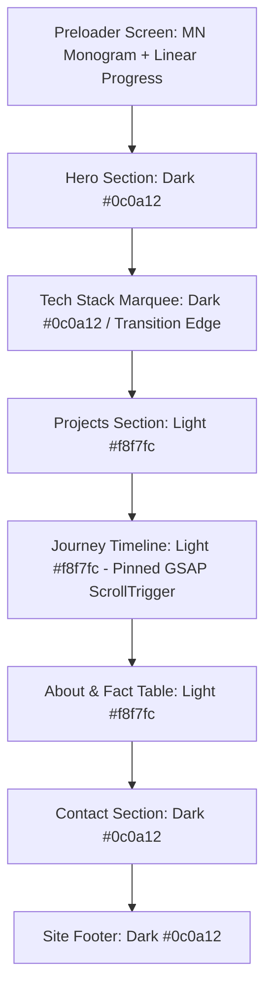

# Project Brief: Muhammad Nafiz Portfolio (`muhammadnafiz.dev`)

> **Lead Front-End & Creative Engineering Brief**  
> **Status:** Planning Phase — Awaiting Client Approval  
> **Target Domain:** `muhammadnafiz.dev`  
> **Language:** English only  

---

## 1. Executive Summary & Goals

### 1.1 The Vision
The personal portfolio for **Muhammad Nafiz (মুহাম্মদ নাফিজ)** serves as the high-impact digital flagship representing his duality as an accomplished web application developer & founder and an evolving Artificial Intelligence Engineer. Based in Mymensingh, Bangladesh, Muhammad Nafiz bridges real-world community utility with cutting-edge software engineering.

### 1.2 Core Objectives
1. **Positioning:** Establish Muhammad Nafiz as a builder who turns real problems into working, scalable products, while showcasing his dedicated trajectory into Deep Learning and AI Engineering.
2. **Flagship Proof:** Highlight three primary initiatives with complete factual integrity:
   - **RoktoFinder** (Live community platform saving lives in Mymensingh).
   - **JaniBD** (Flagship SaaS platform in active development).
   - **Global SaaS** (International SaaS platform in active development).
3. **Creative Engineering Standard:** Deliver an elite, high-performance web experience inspired by the motion and visual rhythm of benchmark sites (dark premium aesthetic, block-grid reveal, dark-to-light transitions, interactive pinned timeline, and silky Lenis + GSAP orchestration) without copying assets, text, or identity.
4. **Zero Fabrication:** Maintain uncompromising credibility. Present only verifiable facts; never invent metrics, awards, press coverage, or client testimonials.

---

## 2. Target Audience & Stakeholders

1. **AI & Tech Recruiters / Engineering Leads:** Assessing technical rigor, engineering depth, mastery of modern web architecture, and commitment to Deep Learning fundamentals.
2. **Potential Collaborators & Partners:** Evaluating execution capability, interface polish, reliability, and product-focused delivery.
3. **Tech Community & Collaborators:** Developers, open-source contributors, and community leaders in Bangladesh and internationally who value genuine problem-solving.

---

## 3. Brand Identity & Personality

| Attribute | Definition | Execution in Interface |
| :--- | :--- | :--- |
| **Grounded Builder** | Builds for real utility, not vaporware | Direct copy, honest stats, live links, community focus. |
| **Ambitious Learner** | Systematically mastering AI engineering | Transparent timeline: Python/ML done → Deep Learning now → Transformers/Agents next. |
| **Refined & Disciplined** | High standards in UI craft & performance | Deliberate typography, smooth 60fps animations, WCAG AA compliance. |
| **Modern Editorial Feel** | Technical yet expressive | Inter Tight sans-serif paired with Instrument Serif italics and JetBrains Mono data labels. |

---

## 4. Site Structure & Section Hierarchy

The portfolio follows a single-page narrative with seamless alternating lighting themes:

### Section Breakdown:
1. **Interactive Preloader (Dark):** Custom SVG MN monogram mark, high-contrast tracking percentage, and smooth timeline exit into the hero.
2. **Hero Section (Dark):** 
   - Overline tag: `WEB APPLICATION DEVELOPER & FOUNDER — MYMENSINGH, BANGLADESH` with pulsing status badge.
   - Large masked headline: *"I'm Muhammad Nafiz. Web developer today, AI engineer in the making."* (*making* set in Instrument Serif Italic with `#a566ff` accent tint).
   - Sub-headline: *"I turn real problems into working products."*
   - Two CTA pill buttons: Primary *"Explore Projects"* (pill accent) & Secondary *"Our Agency"* (dark pill with border).
   - Hero Portrait: Purple studio background portrait (`/public/images/nafiz.png`) unveiled via a block-grid tile reveal transitioning from grayscale to full saturation.
   - Fact / Stats Bar: 3 honest, non-fabricated stat items.
3. **Tech Stack Marquee (Dark):** Continuous marquee ticker labeled `BUILT WITH`, highlighting real production tools (TypeScript, Next.js, Python, PyTorch, Tailwind CSS, etc.) with hover-pause.
4. **Selected Projects (Light):** Smooth GSAP scroll-driven background transition into light surface `#f8f7fc`. Detailed cards with 3D tilt, parallax screenshot showcase, and magnetic outbound links for RoktoFinder, JaniBD, and Global SaaS.
5. **Engineering Journey (Light):** Pinned multi-phase interactive timeline tracking Nafiz's journey from web development & founding to Deep Learning and the future of AI Agents.
6. **About & Fact Matrix (Light):** Concise founder bio coupled with an explicit, high-density tabular breakdown of technical proficiencies, current coursework, and regional background.
7. **Contact / Let's Connect (Dark):** Dynamic transition back to dark `#0c0a12`. Striking editorial headline (*"Say hello."*), and large interactive row links for all social channels.
8. **Footer (Dark):** Clean copyright, tech stack attribution, dynamic Mymensingh local time display, and back-to-top trigger.

---

## 5. Strict Content & Factual Integrity Rules

To protect credibility, all contributors and future modifications must strictly adhere to the following rules:

1. **Zero Fabrication Policy:**
   - **NEVER** invent client numbers, stars, user counts, press citations, awards, or customer testimonials.
   - If a specific metric is not yet confirmed (e.g., exact blood donation counts for RoktoFinder or exact user signups), use qualitative factual statements or placeholder tokens explicitly marked `[TODO: Pending Verification]`.
2. **Project Facts Only:**
   - **RoktoFinder:** Bangla-first blood donor platform for Mymensingh. Started as a community initiative with Al Fatih Islamic Pathagar. Features: donor lookup by blood group & area, 1-click phone call & WhatsApp, emergency blood request system, donor directory, dashboard. Status: **Live** (`https://roktofinder.com`).
   - **JaniBD:** Bangla-first SaaS-style platform. Tagline: *"Your everyday digital companion."* Features: everyday utility tools, quizzes & games, learning library, Bangladesh discovery guide, Tech Skill Map, shareable progress cards, public profiles. Status: **In development (NOT live)**.
   - **Global SaaS:** International SaaS platform currently in active development. Features: scalable SaaS architecture, global market focus, high performance and modern API layer. Status: **In development (NOT live)**. Official name and branding to be announced upon release.
3. **AI Learning Roadmap Facts Only:**
   - Python and Machine Learning fundamentals: **Completed**.
   - Deep Learning: **Currently learning / In progress**.
   - Planned roadmap: Natural Language Processing (NLP), Computer Vision (CV), Generative AI, Transformers, and Autonomous AI Agent development.
4. **Centralized Data Source:**
   - All external URLs, social handles, email, and metadata must reside in a single configuration file (`src/data/site.ts`).
   - No contact forms or serverless database mailers (social & direct channels only).

